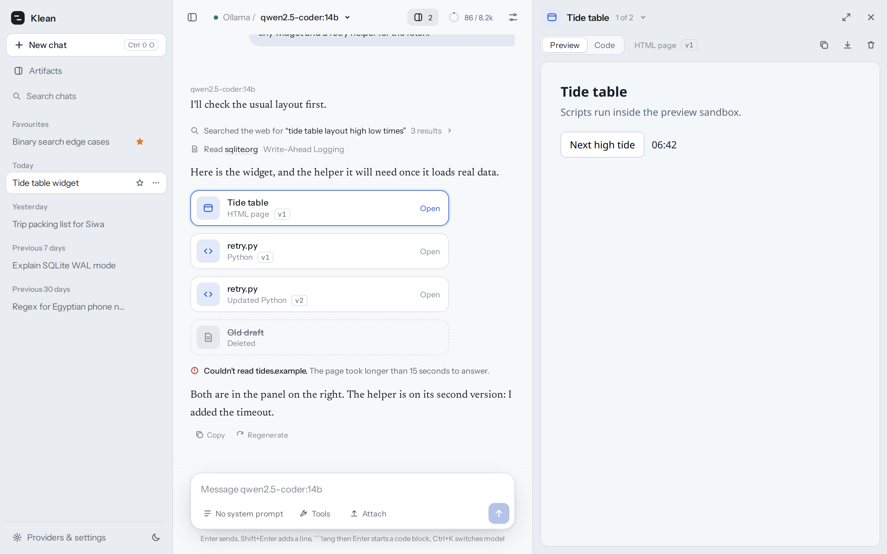
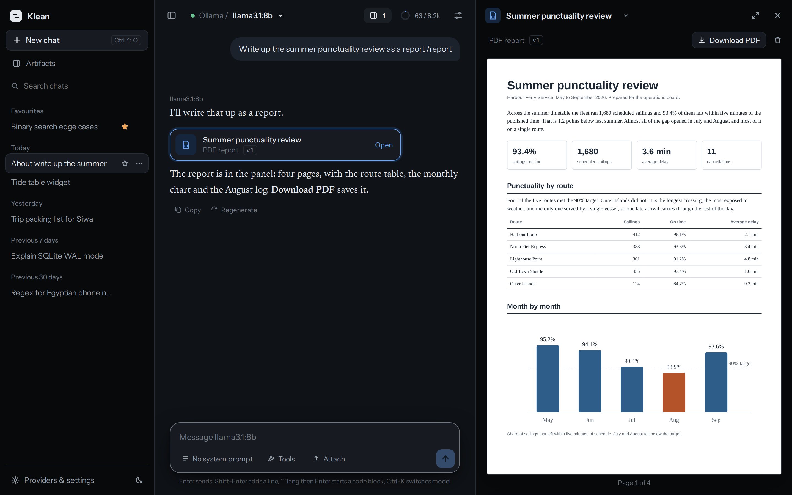
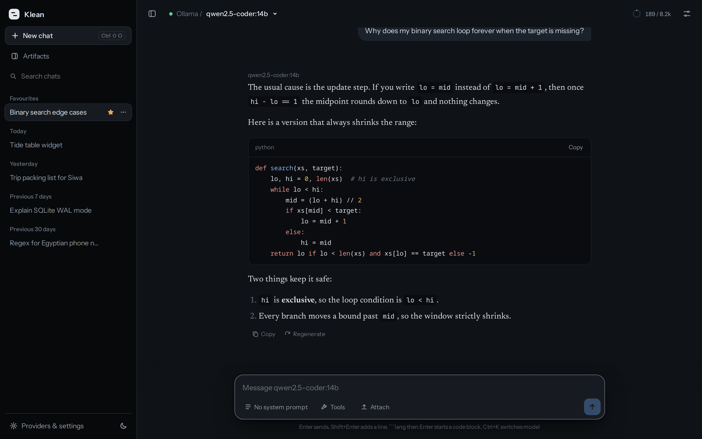
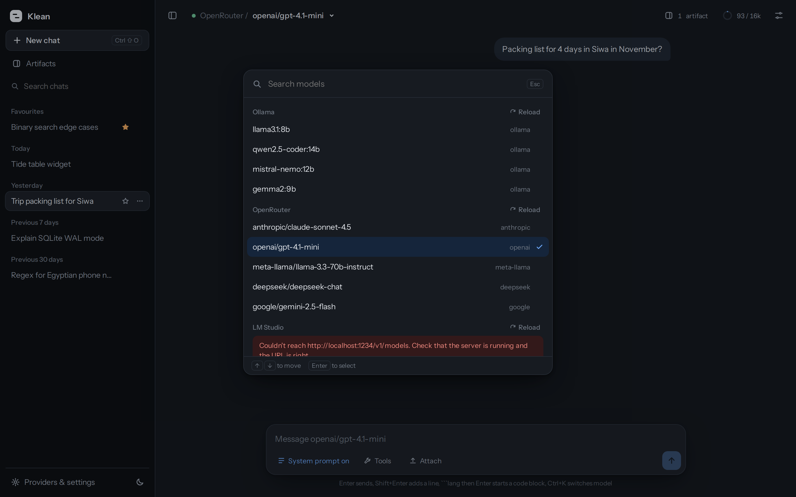
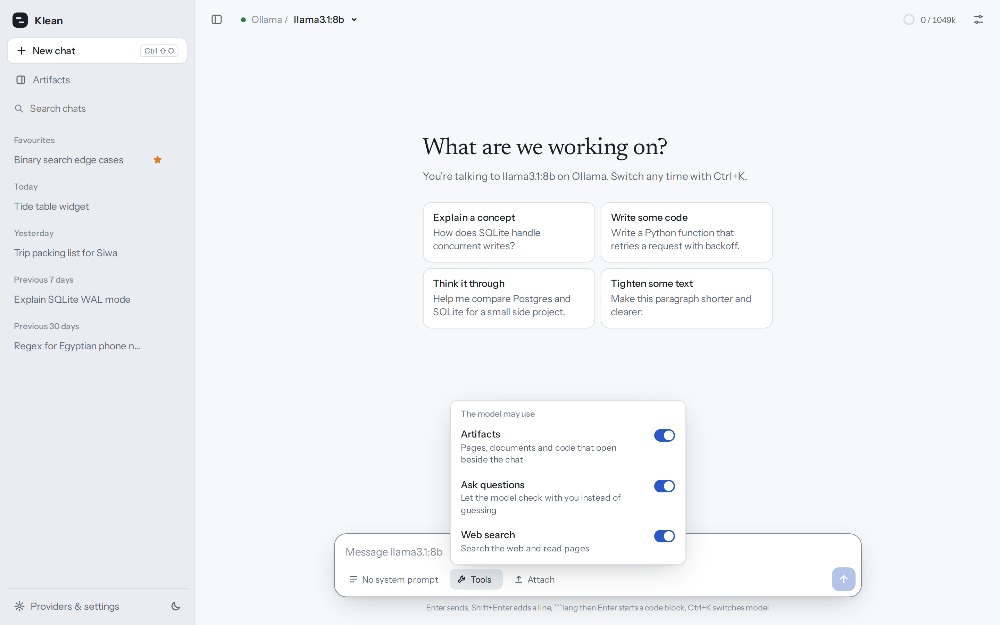
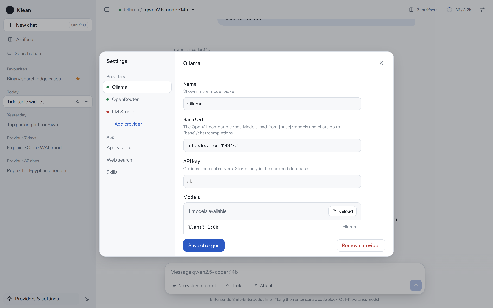

# Klean

   

A chat UI that feels "Klean" and smooth. Connect it to any OpenAI-compatible endpoint and you're good to go.
Everything is stored locally on your machine, and even better, it's all a single executable.

It's an alternative to LibreChat and Open WebUI, which can need dependencies installed first. Klean just works out of the box.

# Screenshots

| | |
|:---:|---|
|  | **Artifacts** Pages, code and documents open beside the chat, with live previews and versions. |
|  | **Reports** The model can write multi-page reports with tables and charts, ready to download as PDF. |
|  | **Code and markdown** Syntax highlighting, tables and LaTeX, in light or dark mode. |
|  | **Any provider, any model** Switch models mid-chat with Ctrl+K. |
|  | **Tools** Artifacts, questions back to you and web search, each toggled per chat. |
|  | **Settings** Add OpenAI-compatible providers, pick a look, set up web search and skills. |

# How to Use
Download the executable for your system from the [Releases](https://github.com/abdallahsoliman00/Klean/releases) page and run it.
It opens a small terminal window, and closing that window stops Klean. It's recommended to move the window to a separate
desktop so that you don't close it by accident, or to run Klean from a terminal multiplexer instead (tmux on macOS and Linux,
psmux on Windows).

1. Klean opens in your browser at **http://localhost:8787**.
2. Open **Providers & settings** (bottom left), choose **Add provider**, and enter a name, the base URL and an API key if
   the provider needs one.
3. Pick a model with **Ctrl+K** and start chatting.

Messages can carry images and text files, and the model can make artifacts (pages, documents, code and PDF reports),
search the web and ask you questions. Chats, settings and keys stay in a database in your user folder.
See [Using Klean](docs/usage.md) for the details.

# Common Providers

| Provider   | Base URL                        |
|------------|---------------------------------|
| Ollama     | `http://localhost:11434/v1`     |
| LM Studio  | `http://localhost:1234/v1`      |
| llama.cpp  | `http://localhost:8080/v1`      |
| OpenRouter | `https://openrouter.ai/api/v1`  |
| OpenAI     | `https://api.openai.com/v1`     |

# Development
You need Go 1.26+ and Node.js 24+. For Windows users, use the PowerShell script in `scripts/` when running PowerShell,
and the `.bat` one in CMD (or use the `.bat` one in PowerShell as well, I can't tell you what to do).

| Script | What it does |
|---|---|
| `./scripts/run.sh` | Builds Klean and runs it |
| `./scripts/dev.sh` | The backend on `:8787` plus the UI with hot reload on `:5173`. `--mock` runs the UI alone, with no backend |
| `./scripts/check.sh` | Everything CI runs: formatting, lint, type checks, the build and the tests. `--fix` fixes what it can |
| `./scripts/build.sh` | Creates one self-contained executable per platform in `dist/` |

See [Development](docs/development.md) for the layout of the code, the test setup and the fake provider.

# Documentation
The documentation can be found in the [docs/](docs/) folder.

- [Using Klean](docs/usage.md): running it, options, where chats are stored, tools and context
- [Development](docs/development.md): the code, scripts, tests and the mock and fake backends
- [API](docs/api.md): the HTTP API and its streamed events

# Contribution
Issues and pull requests are welcome.

1. Fork the repository and make a branch for your change.
2. Run `./scripts/check.sh` and make it pass.
3. Open a pull request saying what changed and why.
